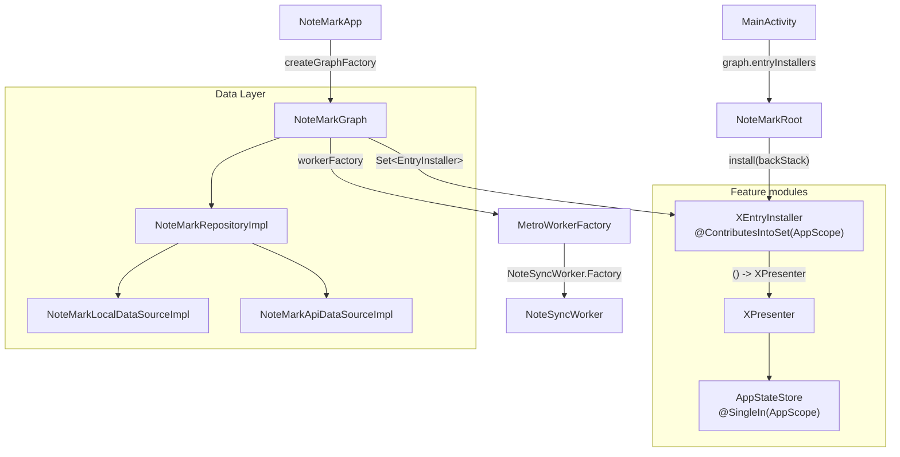

# Requirements

### Overview & Goals
Migrate the dependency injection framework from Koin to Metro (currently 1.5.2) to get compile-time
graph validation through Metro's Kotlin compiler plugin.

Navigation entries are registered per feature: each feature module contributes an `EntryInstaller`
into the app graph, so the app module no longer builds every screen or reaches into the graph from
Compose.

### Scope
- **In Scope**:
    - Adding the Metro Gradle plugin and applying it to every module that declares injected types.
    - Defining a central `NoteMarkGraph`.
    - Migrating all service, repository, and UI-related dependencies.
    - Assisted injection for components with runtime parameters (`EditNotePresenter`,
      `EditNoteStateMachineFactory`, `NoteSyncWorker`).
    - Integrating Metro with WorkManager via a custom `WorkerFactory`.
    - Registering Navigation 3 entries through graph-contributed `EntryInstaller`s.
    - One app-wide `AppStateStore` shared by the presenters that need the app state.
    - Complete removal of Koin.
- **Out of Scope**:
    - Functional changes to the app's business logic.
    - Refactoring state management (FlowRedux/Molecule) beyond sharing the app state machine.

### Functional Requirements
- The app must continue to function as before, with all features (login, note list, edit note,
  sync) operational.
- Presenters must be retained across recomposition and configuration changes (using `retain`).
- All screens must observe the same `AppState`, so an event consumed on one screen is gone for the
  others too.
- `NoteSyncWorker` must correctly inject its dependencies via Metro.

# Technical Design

### Previous Implementation (Koin)
- Uses Koin for DI, defined in `AppModule.kt`.
- Uses `single`, `factory`, and `worker` definitions.
- Uses named qualifiers for `DataStore` and `CoroutineDispatcher`.
- Uses `parametersOf` for runtime parameters (e.g., `noteId` for `EditNotePresenter`).
- Injected in Compose using `KoinJavaComponent.get()` within `EntryBuilders`.

### Key Decisions
- **Compiler plugin, not KSP**: Metro runs as a Kotlin compiler plugin. Modules apply
  `alias(libs.plugins.metro)`; no KSP processor is needed for DI.
- **Single app-wide graph**: `NoteMarkGraph` is a `@DependencyGraph(AppScope::class)` and is the only
  graph. Contributions from feature modules are merged into it through `AppScope`.
- **`EntryInstaller` instead of a CompositionLocal graph**: Each feature declares an
  `@Inject @ContributesIntoSet(AppScope::class)` class implementing `EntryInstaller`. The graph
  exposes `Set<EntryInstaller>`, and `NoteMarkRoot` installs every one into the `entryProvider`.
  The earlier `LocalNoteMarkGraph` / `EntryBuilder` approach has been removed.
- **Presenters arrive as function providers**: An installer takes `() -> XPresenter` (Metro supports
  Kotlin function types as providers) and calls it inside `retain { }`. The presenter is created
  only when its entry is first shown, and the installer holds no presenter instance, so it can be
  `@Stable` and live in the graph.
- **Assisted injection**: `EditNotePresenter.Factory` (`@AssistedFactory`) takes `noteId`.
  `EditNoteEntryInstaller` injects the factory and calls `create(noteId)` inside `retain { }`.
- **Shared app state**: `AppStateStore` is `@SingleIn(AppScope::class)` and launches the single
  `AppStateMachine` in the `@AppBackgroundScope`. `AppPresenter`, `LauncherPresenter`,
  `NoteListPresenter`, and `SettingsPresenter` inject it instead of creating their own machine.
- **Custom WorkerFactory**: `MetroWorkerFactory` injects `NoteSyncWorker.Factory` and creates the
  worker for WorkManager.

### Proposed Changes
- **Dependency definitions**:
    - Annotate implementation classes with `@Inject`.
    - Use `@Provides` in `AppModule` (an interface the graph extends) for third-party instances
      (Ktor `HttpClient`, SQLDelight `SqlDriver`, `DataStore`) and interface bindings.
- **Qualifiers** (in `common-core`, package `core.di`):
    - `@AppBackgroundDispatcher`, `@AppBackgroundScope`, `@UserDataStore`, and `@SyncDataStore`
      replace Koin's `named()`.
- **Navigation**:
    - `EntryInstaller` lives in `common-navigation-api`:
      ```kotlin
      @Stable
      fun interface EntryInstaller {
        fun EntryProviderScope<NavKey>.install(backStack: NavBackStack<NavKey>)
      }
      ```
      The back stack is passed at install time because the composition owns it, not the graph.
    - Shared back stack helpers (`goToNoteListAfterLogin`, `resetToLauncherAfterLogout`,
      `clearNoteEditNavKeys`, `isSettingsOpen`, ...) move to `NavKeysExtensions.kt` in
      `common-navigation-api` so feature modules can use them.
    - A feature installer looks like:
      ```kotlin
      @ContributesIntoSet(AppScope::class)
      @Inject
      class LoginEntryInstaller(private val loginPresenter: () -> LoginPresenter) : EntryInstaller {
        override fun EntryProviderScope<NavKey>.install(backStack: NavBackStack<NavKey>) {
          entry<LoginNavKey> {
            val presenter: LoginPresenter = retain { loginPresenter() }
            LoginEntry(
              loginPresenter = presenter,
              navigateToRegistration = { backStack.add(RegistrationNavKey) },
              navigateToAfterLogin = { backStack.goToNoteListAfterLogin() },
            )
          }
        }
      }
      ```
    - `NoteMarkGraph` exposes `val entryInstallers: Set<EntryInstaller>`.
    - `MainActivity` reads the set once from `NoteMarkApp.getGraph()`, converts it with
      `toPersistentSet()`, and passes it to `NoteMarkRoot`.
    - `NoteMarkRoot` builds the entry provider with
      `entryProvider { entryInstallers.forEach { with(it) { install(backStack) } } }`.

### Architecture Diagram


### File Structure Changes
- **Added**:
    - `app/src/main/java/com/dhimandasgupta/notemark/app/di/NoteMarkGraph.kt`: The Metro graph and
      `AppModule` providers.
    - `app/src/main/java/com/dhimandasgupta/notemark/app/di/MetroWorkerFactory.kt`: Custom
      `WorkerFactory` for Metro.
    - `common-core/src/main/java/com/dhimandasgupta/notemark/core/di/Qualifiers.kt`: Qualifier
      annotations.
    - `common-navigation-api/src/main/java/com/dhimandasgupta/notemark/common/navigation/EntryInstaller.kt`.
    - `common-navigation-api/src/main/java/com/dhimandasgupta/notemark/common/navigation/NavKeysExtensions.kt`
      (moved from `app/.../nav/`).
    - `common-state-event-impl/.../common/state/impl/AppStateStore.kt`: The app-wide state store.
    - One `XEntryInstaller.kt` per feature: `feat-launcher`, `feat-login`, `feat-registration`,
      `feat-notelist`, `feat-addnote`, `feat-editnote`, `feat-settings`.
- **Modified**:
    - `app/src/main/java/com/dhimandasgupta/notemark/app/NoteMarkApp.kt`: Creates the graph and
      configures WorkManager with `MetroWorkerFactory`.
    - `app/src/main/java/com/dhimandasgupta/notemark/app/activity/MainActivity.kt`: Passes
      `graph.entryInstallers` to `NoteMarkRoot`.
    - `app/src/main/java/com/dhimandasgupta/notemark/app/nav/NoteMarkRoot.kt`: Takes
      `PersistentSet<EntryInstaller>` and installs them; no per-feature entries remain here.
    - All presenters, repositories, and data sources: `@Inject` and no Koin imports. Presenters that
      read app state inject `AppStateStore`.
    - `NoteSyncWorker.kt`: `@AssistedInject` with an `@AssistedFactory`.
- **Removed**:
    - `app/src/main/java/com/dhimandasgupta/notemark/app/di/AppModule.kt` (Koin module).
    - `LocalNoteMarkGraph` and every feature's `XEntryBuilder.kt`.
    - `app/src/main/java/com/dhimandasgupta/notemark/app/nav/NavKeysExtensions.kt`.

# Plan

### ✓ Step 1: Add Metro dependencies and configuration
- Add `metro` (now 1.5.2) and the `dev.zacsweers.metro` plugin to `gradle/libs.versions.toml`.
- Declare the plugin with `apply false` in the root `build.gradle.kts`.
- Apply `alias(libs.plugins.metro)` in `app` and in every library module that declares injected or
  contributed types (`common-core`, `common-data`, `common-state-event-impl`, and all `feat-*`).

### ✓ Step 2: Implement Metro Graph and migrate core dependencies
- Create `NoteMarkGraph.kt` annotated with `@DependencyGraph(AppScope::class)` and a
  `@DependencyGraph.Factory` taking `@Provides context: Context`.
- Define `@Qualifier` annotations in `common-core`: `@AppBackgroundDispatcher`,
  `@AppBackgroundScope`, `@UserDataStore`, and `@SyncDataStore`.
- Move the `HttpClient`, `SqlDriver`/`NoteMarkDatabase`, and `DataStore` providers from the Koin
  module into `AppModule`.
- Add `@Inject` to repositories and data sources, and bind each interface with a `@Provides`
  function.

### ✓ Step 3: Migrate Presenters and StateMachine Factories
- Add `@Inject` to all presenters (`LauncherPresenter`, `LoginPresenter`, etc.).
- Make `EditNotePresenter` `@AssistedInject` with `noteId`, exposing an `@AssistedFactory`
  `Factory`, and build `EditNoteStateMachineFactory` from `noteId` through
  `EditNoteStateMachineFactoryBuilder`.
- Use `@Inject` on the other state machine factories.

### ✓ Step 4: Initialize Metro and integrate with WorkManager
- Create the graph in `NoteMarkApp` with `createGraphFactory<NoteMarkGraph.Factory>()`.
- Implement `MetroWorkerFactory` to create `NoteSyncWorker` through `NoteSyncWorker.Factory`.
- Set `MetroWorkerFactory` in the WorkManager `Configuration`.
- Switch `NoteSyncWorker` from Koin's `by inject` to constructor injection.

### ✓ Step 5: Integrate Metro with Compose UI (superseded by Step 7)
- First pass: provided the graph through `LocalNoteMarkGraph` and resolved presenters inside each
  `XEntryBuilder` with `LocalNoteMarkGraph.current`.
- Removed all Koin `get()` and `parametersOf()` calls from the UI layer.
- This approach was replaced by `EntryInstaller` contributions in Step 7.

### ✓ Step 6: Finalize Koin removal and cleanup
- Delete the Koin `AppModule.kt`.
- Remove Koin initialization from `NoteMarkApp.kt`.
- Remove Koin imports from all modified files.
- Remove Koin dependencies from `gradle/libs.versions.toml` and `app/build.gradle.kts`.

### ✓ Step 7: Register navigation through `EntryInstaller`
- Add the `EntryInstaller` fun interface to `common-navigation-api`.
- Move the back stack helpers into `common-navigation-api/NavKeysExtensions.kt`.
- Replace each feature's `XEntryBuilder` with an `@Inject @ContributesIntoSet(AppScope::class)`
  `XEntryInstaller`:
    - Inject the presenter as `() -> XPresenter` (or `EditNotePresenter.Factory` for edit note) and
      create it with `retain { }` inside `entry<XNavKey> { }`.
    - Keep entry metadata (`ListDetailSceneStrategy.listPane` / `detailPane`) in the installer.
- Expose `val entryInstallers: Set<EntryInstaller>` on `NoteMarkGraph`.
- Pass the set from `MainActivity` to `NoteMarkRoot` and install every entry in `entryProvider`.
- Delete `LocalNoteMarkGraph` and the per-feature entry builders.

### ✓ Step 8: Share one app state machine through `AppStateStore`
- Add `AppStateStore` (`@SingleIn(AppScope::class)`), which launches the `AppStateMachine` in the
  `@AppBackgroundScope` and exposes `state` and `dispatch`.
- Inject `AppStateStore` into `AppPresenter`, `LauncherPresenter`, `NoteListPresenter`, and
  `SettingsPresenter` instead of creating a machine per presenter.
- Update presenter and state machine tests, and add `AppStateStoreTest`.

### Step 9: Use function providers in installers (in progress)
- Replace `Provider<XPresenter>` with `() -> XPresenter` in every `XEntryInstaller` and drop the
  `dev.zacsweers.metro.Provider` imports. Done in the working tree for launcher, login,
  registration, note list, add note, and settings; not yet committed.
- Build to confirm Metro resolves the function-typed providers.
