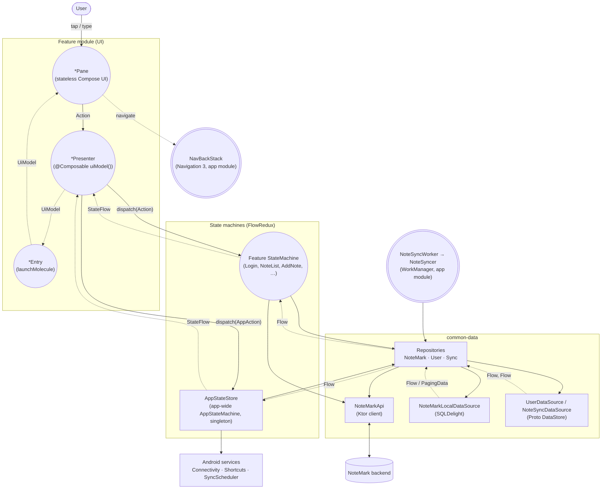
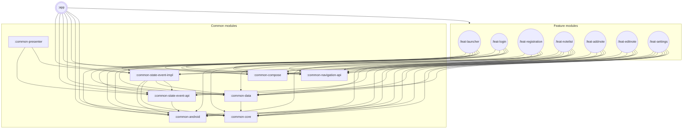

# This is an experiment with [FlowRedux](https://github.com/freeletics/FlowRedux) and [Molecule](https://github.com/cashapp/molecule)

## Building the Project

A comprehensive build script `build.sh` is provided in the project root:

```bash
# Display help and available options
./build.sh --help

# Run full pipeline: clean, stability check, lint, tests, and assemble
./build.sh full

# Build debug APK
./build.sh debug

# Build release APK and App Bundle (AAB)
./build.sh release

# Run all quality checks (stability, lint, unit tests)
./build.sh check

# Run unit tests only
./build.sh test
```

## Project Structure

```
NoteMark
├── app                        # Application module: MainActivity, Metro DI graph (NoteMarkGraph),
│                              # Navigation 3 root (NoteMarkRoot), deep links, WorkManager sync
├── build-logic/convention     # Gradle convention plugins (android app/library, compose, jvm library)
│
├── common-core                # Pure JVM: coroutine/Flow helpers, date & string extensions, DI qualifiers
├── common-android             # Android helpers: connectivity, sync scheduler, app shortcuts, status bar
├── common-compose             # Design system: theme, colors, typography, shared UI components
├── common-data                # Data layer: repositories, SQLDelight (notes), Proto DataStore (user, sync),
│                              # Ktor HTTP client & NoteMark API
├── common-navigation-api      # Navigation 3 NavKeys and the EntryInstaller contract
├── common-state-event-api     # App-wide AppState / AppAction / Event contracts
├── common-state-event-impl    # AppStateMachineFactory (FlowRedux) and the singleton AppStateStore
├── common-presenter           # AppPresenter over AppStateStore (not yet consumed by other modules)
│
├── feat-launcher              # Splash / routing based on login state
├── feat-login                 # Login screen
├── feat-registration          # Registration screen
├── feat-notelist              # Paged note list, delete dialog, list-detail pane
├── feat-addnote               # Create note
├── feat-editnote              # Edit note
└── feat-settings              # Sync interval, sync now, logout
```

Every feature module follows the same shape:

| File | Role |
|---|---|
| `*EntryInstaller` | Registers the screen's `NavKey` entry; contributed to the DI graph via `@ContributesIntoSet(AppScope::class)` |
| `*Entry` | Composable that runs the presenter with Molecule and wires navigation callbacks |
| `*Pane` | Stateless UI that renders the `UiModel` and emits actions |
| `*Presenter` | `@Composable` presenter that turns state-machine state into a `UiModel` and forwards actions |
| `*StateMachineFactory` | FlowRedux state machine holding the screen's business logic |

## Data Flow

Unidirectional: the UI sends actions down, state flows back up.

**Legend:** double circle = lives in `:app`, circle = lives in a feature module, rectangle = lives in a common module, stadium = the user, cylinder = external backend.



- **Solid arrows**: actions and calls flowing down.
- **Dotted arrows**: state flowing back up as `Flow` / `StateFlow`.
- `AppStateStore` is the single app-wide state (login status, connectivity, sync settings, one-shot `AppEvent`s) shared by `feat-launcher`, `feat-notelist` and `feat-settings`.
- Screen-specific logic lives in each feature's own `*StateMachineFactory`, created per presenter via `launchIn(scope)`.

## Module Dependency Diagram

Project-module `implementation` dependencies (test-only dependencies omitted).

**Legend:** double circle = application module, circle = feature module, rectangle = common/library module.



Key points:

- `:app` is the only module that depends on feature modules. Features never depend on each other; they navigate through `NavKey`s defined in `:common-navigation-api`.
- Feature navigation entries reach `:app` through Metro multibindings (`Set<EntryInstaller>`), not through direct references.
- `:common-core` is a pure JVM module at the bottom of the graph.
- Build configuration is shared through the convention plugins in `build-logic` (`notemark.android.application`, `notemark.android.library`, `notemark.android.compose`, `notemark.jvm.library`).
